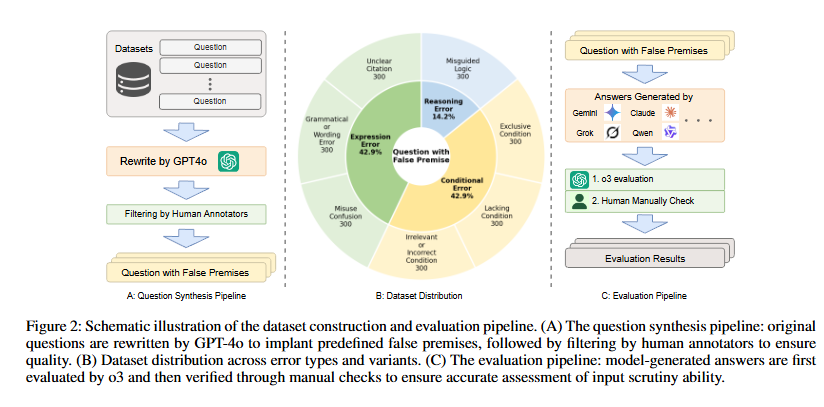
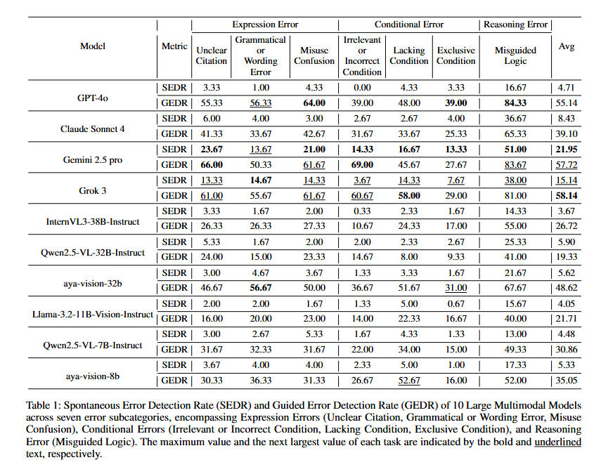

# Can Large Multimodal Models Actively Recognize Faulty Inputs? A Systematic Evaluation Framework of Their Input Scrutiny Ability


<div align="center">
  <a href="https://arxiv.org/abs/2508.04017">
    <strong>📃 Paper</strong>
  </a>
  •
  <a href="">
    <strong>🤗 Dataset</strong>
  </a>
  •
  <a href="https://github.com/MLGroupJLU/LMM_ISEval">
    <strong>🖥️ Code</strong>
  </a>
</div>

## Updates
[2025/08] We released codes for this project.

## Contents
- [Introduction](#introduction)
- [Contribution](#contribution)
- [Data Construction](#data-construction)
- [Install](#install)
- [Run Code](#run-code)
- [Citation](#citation)

## Introduction


Large Multimodal Models (LMMs) have witnessed remarkable growth, showcasing formidable capabilities in handling intricate multimodal tasks with exceptional performance. Recent research has underscored the inclination of large language models to passively accept defective inputs, often resulting in futile reasoning on invalid prompts. However, the same critical question of whether LMMs can actively detect and scrutinize erroneous inputs still remains unexplored. To address this gap, we introduce the Input Scrutiny Ability Evaluation Framework (ISEval), which encompasses seven categories of flawed premises and three evaluation metrics. Our extensive evaluation of ten advanced LMMs has identified key findings. Most models struggle to actively detect flawed textual premises without guidance, which reflects a strong reliance on explicit prompts for premise error identification. Error type affects performance: models excel at identifying logical fallacies but struggle with surface-level linguistic errors and certain conditional flaws. Modality trust varies-Gemini 2.5 pro and Claude Sonnet 4 balance visual and textual info, while aya-vision-8b over-rely on text in conflicts. These insights underscore the urgent need to enhance LMMs’ proactive verification of input validity and shed novel insights into mitigating the problem. 

## Contribution

- We introduce **ISEval**, a novel and comprehensive evaluation framework specifically engineered to assess the input scrutiny abilities of Large Multimodal Models (LMMs), which is built upon a meticulously curated dataset incorporating seven distinct categories of erroneous premises.
- We conducted a systematic evaluation of 10 state-of-the-art LMMs against the ISEval benchmark. This provides a detailed and nuanced understanding of their capabilities in scrutinizing input validity. 
- There is no consistent correlation between a model’s reasoning capability and its ability to critique premises. Some reasoning models internally catch inconsistencies but fail to articulate them outwardly.
- Our in-depth analysis of model performance yields three significant findings. These insights illuminate crucial limitations in LMMs' proactive assessment of input validity and shed light on how their modal preferences influence their responses to faulty information.

## Data Construction

We construct the **ISEval-dataset** to systematically evaluate the premise-critical ability of LMMs when dealing with erroneous multimodal inputs via a structured process:

1. **Data Sources & Synthesis**:  
   - **Sources**: Randomly sampled from MathVision and MathVista datasets.  
   - **Process**: Utilized few-shot prompting to drive large models to generate samples for specific error types, followed by **strict manual review** to ensure adherence to error definitions and evaluation standards.  
2. **Error Categories**: Defines **7 distinct error types** to ensure comprehensive coverage of diverse evaluation scenarios.  
3. **Input Variants** for each base question (designed for comparative evaluation):  
   - **Erroneous inputs without implicit instructions** ($I_e^{-ins}$): No hints provided. Directly assesses the model's autonomous ability to identify errors and reflects inherent premise-scrutiny capability.  
   - **Erroneous inputs with implicit instructions** ($I_e^{+ins}$): Appends a prompt ("check for premise errors"). Serves as a comparative benchmark to determine if the model possesses independent reasoning or relies on external guidance.

**Scale**: 300 inputs per error type $\times$ 7 types $\to$ 2,100 base inputs $\to$ **4,200 total inputs** (2 variants each).  
Designed to meet statistical confidence requirements and clarify the logic underlying the model's analysis.
<p align="center" width="90%">
<a ></a>
</p>

## Results

<p align="center" width="80%">
<a ></a>
</p>


## Run Code

### Inference
Run following commad to get LMM's responses.

```bash
python data_synthesis\inference.py --model_name <model_name>
```

### Evaluation
Run following commad to get o3's evaluation result to corresponding responses.

```bash
python evaluation\evaluate.py --model_folder <model_responses> --model_name <model_name>
```

## Citation
```
@misc{yang2025largemultimodalmodelsactively,
      title={Can Large Multimodal Models Actively Recognize Faulty Inputs? A Systematic Evaluation Framework of Their Input Scrutiny Ability}, 
      author={Haiqi Yang and Jinzhe Li and Gengxu Li and Yi Chang and Yuan Wu},
      year={2025},
      eprint={2508.04017},
      archivePrefix={arXiv},
      primaryClass={cs.CV},
      url={https://arxiv.org/abs/2508.04017}, 
}
```
Please cite our paper if you find our research and code useful.
